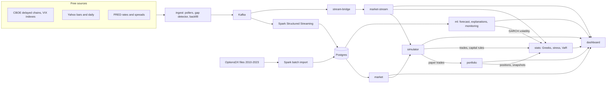

# Quantisti: SPX Options Trading Simulator

Quantisti prices, backtests and paper-trades **S&P 500 index (SPX) options** strategies on real market data that a
Kafka + Spark pipeline collects from free sources. It forecasts next week's SPX range with a validated volatility
model, recommends a strategy from that forecast, and tracks a $30,000 paper account with portfolio-level risk
(Greeks, stress tests, VaR). Python microservices, a Next.js trading dashboard and a marketing site.

SPX options are European, cash-settled, x100, on 5-point strikes, and expire every weekday on the NYSE calendar.

---

## What it does

- **Option chains for any day since 2010.** Real end-of-day quotes for 2010-2023 (OptionsDX) and from October 2026
  (CBOE, collected live). The years in between are priced with Black-Scholes from VIX, a skewed volatility smile and
  the FRED T-bill rate. Implied volatility and Greeks are recomputed from mid prices against a forward implied by
  put-call parity, since vendor IVs are often inconsistent.
- **A weekly SPX range forecast** (5/10/50/90/95% quantiles of next week's expiry close) and one for every listed
  expiry up to 10 sessions out. Models were chosen on 2014-2020 and scored once on a 2021-2026 holdout: a gradient-
  boosted volatility model didn't beat GARCH (Diebold-Mariano p = 0.58), so GARCH is served, with the boosted model
  as a second opinion. Each forecast comes with its explanation (GARCH's variance breakdown, SHAP for the second
  opinion), and live coverage is monitored for drift.
- **Strategy recommendations** ranked by expected P&L under the forecast after half the bid/ask, over max loss,
  defined risk only.
- **Backtests** of strategy templates (iron condors, spreads, straddles, strangles, calendars...): enter at the close,
  price every leg from that day's chain, settle at the expiry close, and report P&L, win rate, drawdown and Sharpe/Sortino.
- **Paper trading** on ~15-minute-delayed SPX chains: a $30,000 account where defined-risk trades hold their max loss
  and uncovered shorts CBOE index-option margin, orders beyond the available capital are refused, and open trades
  settle automatically 30 minutes before their expiry's close.
- **Portfolio and risk.** Positions netted across trades, an equity curve from snapshots every 15 minutes, performance
  against SPX (Sharpe, Sortino, drawdown, beta, per-strategy stats), dollar Greeks, stress tests (an SPX x IV grid and
  replays of the largest real SPX days, with margin calls flagged), and 1-day VaR / expected shortfall by three methods,
  stored daily and backtested (Kupiec, Christoffersen). Before placing a trade, the dashboard shows what it would do to
  all of these.
- **A streaming data pipeline** that keeps all of this current: intraday bars, option chains and daily data flow
  through Kafka into Postgres via Spark, and a gap detector finds and refills missing sessions.

## Architecture



| Service | Port | What it does |
|---|---|---|
| `market` | 8081 | SPX daily and intraday data, VIX, option chains with IV and Greeks, expiry calendar |
| `simulator` | 8082 | strategy templates, backtests, live strategies, the paper account |
| `portfolio` | 8083 | net positions, account snapshots, performance, trade history and CSV ([README](services/portfolio/README.md)) |
| `stats` | 8084 | Greeks, stress tests, VaR / expected shortfall and its backtest, pre-trade what-if ([README](services/stats/README.md)) |
| `ml` | 8085 | weekly and per-expiry range forecasts, explanations, calibration monitoring, the dataset and evaluation CLI |
| `market-stream` | 8090 | latest quotes in memory, REST and WebSocket |
| `ingest` | 8088 | pollers, gap detector, backfill worker ([README](services/ingest/README.md)) |
| `stream-bridge` | | Kafka -> market-stream |
| `spark` | 4040 (UI) | Kafka -> Postgres streaming job, OptionsDX batch import ([README](services/stream-processing/README.md)) |
| `strategy-dashboard` | 3000 | Next.js 14 trading dashboard: strategies and forecast, option chain, paper trading, portfolio and risk |
| `landing` | 3000 | Next.js 15 marketing site |
| `gateway` | 8080 | health-check stub; authentication is planned |

Kafka UI runs on 8089. More detail in [docs/architecture.md](docs/architecture.md).

## Data coverage

| Data | Source | Coverage |
|---|---|---|
| SPX / VIX / 3-month T-bill, daily | Yahoo, CBOE, FRED | 2010 to today |
| VIX9D, VIX3M, VVIX, SKEW, credit and curve spreads | CBOE, FRED | 2010 to today (VIX9D from 2011) |
| SPX / VIX intraday | Yahoo, ~15 min delayed | 1m from ~30 days back, 5m 60 days, 1h ~2 years, then collected continuously |
| SPX option chains | OptionsDX (free files) | 2010-2023 end of day, no open interest, 43 sessions missing |
| SPX option chains | CBOE delayed quotes | from 2026-10-01, every 90 s in market hours plus the close, with open interest |
| SPX option chains | none free | 2024 to Sep 2026: synthetic (Black-Scholes from VIX) |

Missing data is reported, never invented: the gap detector marks what no free source can supply as `unrecoverable`.

## Quick start

```bash
docker compose up -d --wait postgres
# apply schema/sql/*.sql and the ML migrations, load daily history, then:
docker compose -f docker-compose.yml -f docker-compose.streaming.yml up -d --build
```

The full sequence, including loading data and the dashboard, is in [docs/getting-started.md](docs/getting-started.md).

## Tech stack

**Backend:** Python 3.11, FastAPI, psycopg2, exchange_calendars · **Data:** PostgreSQL 16, Apache Kafka 3.9 (KRaft),
Spark 3.5 Structured Streaming, confluent-kafka, yfinance · **ML:** scikit-learn, arch (GARCH), SHAP, MLflow
· **Frontend:** Next.js, React, Recharts, Vitest · **Tooling:** Docker Compose, pytest, ruff, GitHub Actions (blocking CI)

## Planned

Not built yet: authentication through the gateway with per-user paper accounts (the RBAC schema exists), an agent
layer (MCP server and chat over these APIs), event-calendar features for the forecast (CPI, jobs, FOMC), the
original multi-signal strategy scoring (IV percentile, trend, sentiment), monitoring, and cloud deployment.
