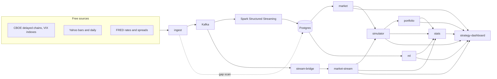
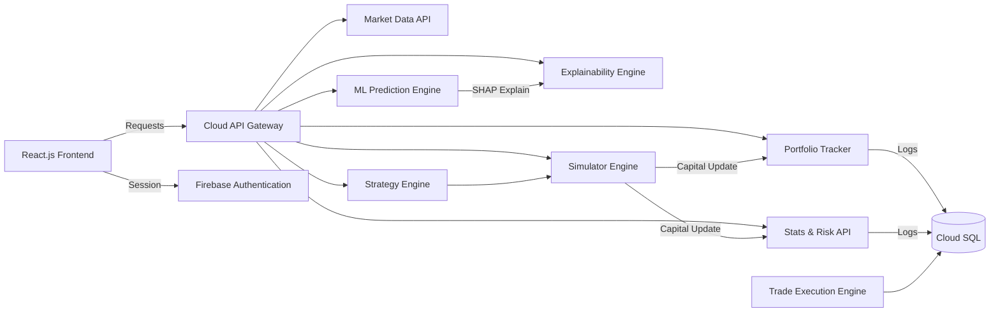

# Architecture

What is built, how the services depend on each other, and how that compares with the original design.

## Services and data flow

| Service | Owns | Reads from |
|---|---|---|
| ingest | `ingest_gaps`; publishes market data to Kafka, never writes it | CBOE, Yahoo, FRED; Postgres for the gap scan |
| Spark (stream-processing) | `underlying_daily`, `vix_daily`, `rates_daily`, `index_daily`, `intraday_bars`, `option_chain_snapshots` | Kafka; OptionsDX files for the batch import |
| stream-bridge | nothing (pushes the latest quote) | Kafka |
| market-stream | an in-memory latest quote per symbol | stream-bridge |
| market | nothing | market-data tables |
| ml | `weekly_features`, `weekly_labels`, `weekly_forecasts`, `expiry_forecasts`, `weekly_oi_levels` | market-data tables |
| simulator | strategies, backtests, paper trades and the paper account, including the capital rules | market, market-stream |
| portfolio | `portfolio_snapshots` | simulator (paper trades over HTTP), market-stream; SPX and rates for performance |
| stats | `risk_var` | portfolio (net positions), simulator (trades, account, capital rules), market-stream, ml (GARCH volatility), SPX / VIX history |

Services call each other over HTTP and never read another service's tables. Market data (SPX, VIX, rates) is the
exception: it is shared, read-only reference data that every analytical service reads directly. Each service starts
even if Postgres or a downstream service is down and reports that through its health checks or a 502/503.

Service-level detail is in each service's README and in `CLAUDE.md`.

## Original design and what became of it

The first version of this project (NIFTY options, India) planned the architecture below. It is kept for reference.

| Planned | Status |
|---|---|
| Market Data API | Built (`market`), on SPX, fed by the streaming pipeline instead of direct API calls |
| Strategy Engine | Partly: strategy templates, live strategies and a forecast-based recommendation; the multi-signal scoring in [strategy-engine.md](strategy-engine.md) is not built |
| ML Prediction Engine | Built (`ml`): a weekly range forecast rather than a strategy classifier |
| Explainability Engine | Built inside `ml` (GARCH breakdown, SHAP); no separate service |
| Simulator Engine | Built (`simulator`): backtests and the paper account |
| Portfolio Tracker | Built (`portfolio`) |
| Stats & Risk API | Built (`stats`) |
| API gateway + Firebase auth | Not built: `gateway` is a stub and the RBAC schema ([security-rbac.md](security-rbac.md)) isn't enforced |
| Cloud SQL, Cloud Run, Stackdriver | Not built: everything runs in Docker Compose with Postgres; no monitoring yet |
| Trade Execution Engine | Out of scope: paper trading only |
