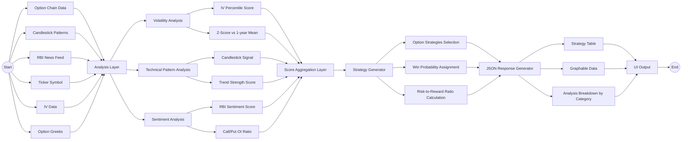

# Strategy engine: original design

**Status: not built.** This is the multi-signal scoring planned for the first (NIFTY) version: market signals scored
by category, aggregated, and turned into strategies with a win probability and risk/reward. What exists instead is
the forecast-based recommendation in the dashboard (`services/strategy-dashboard/data/recommend.ts`): each defined-
risk strategy is scored by its expected P&L under the ml service's range forecast, after half the bid/ask, over its max
loss. The call/put open-interest ratio and VIX-based volatility features exist (market service, ml features); the IV
percentile score, candlestick and trend signals, and sentiment (the RBI news feed would now be Fed/news sentiment)
do not.

